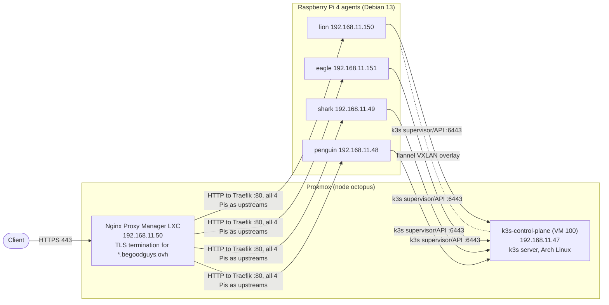

# home-lab-k3s-ansible

Documentation of the home-lab **k3s cluster**: its topology, node roles, k3s configuration, cluster networking,
node OS preparation and the procedures to install, upgrade, join and rotate nodes.

> **Scope.** This repo owns the *cluster platform*. It deliberately links out instead of duplicating:
>
> | Topic | Owner |
> |---|---|
> | Lab CIDRs, `<service>.begoodguys.ovh` catalog, hardware inventory & energy, general security | `home-lab-briefing` |
> | The control-plane VM as a Proxmox guest (vmid 100, HA, backups, 2-node quorum risk) | `home-lab-proxmox-ansible` |
> | DHCP reservations, NAT, firewall | `home-lab-mikrotik-gateway-iac` |
> | Argo CD and every workload/app running on the cluster | `home-lab-k3s-argocd` |
> | k3s topology, node roles/labels/taints, server/agent config, datastore, CNI/CIDRs, bundled components, k3s-specific node prep (cgroups, kernel params), k3s install/upgrade/join/rotate playbooks, failure modes | **this repo** |
> | OS patching of the Pis, the Arch VM and the Proxmox nodes | `home-lab-os-ansible` (**planned**, not created yet) |
>
> Status of this phase: documentation only, written **as if the target design is fully in place**. No Ansible code
> exists yet. Section [Known drift](#known-drift-observed-vs-target) lists where the live agents currently differ.

## Topology



| Path | Description |
|---|---|
| Cluster control | Agents connect to the server at `https://192.168.11.47:6443` (supervisor + kube-apiserver). |
| Ingress (north–south) | Client → NPM (TLS terminated) → plain HTTP to Traefik on any of the four Pi IPs (ServiceLB; all four are NPM upstreams) → pod. |
| Pod traffic (east–west) | Flannel VXLAN overlay between all nodes (UDP 8472). |

## Nodes

| Node | Role | Host | Address | OS | Arch | Resources |
|---|---|---|---|---|---|---|
| `k3s-control-plane` | server (control plane, embedded SQLite datastore; runs no workloads) | Proxmox VM 100 on `octopus` | 192.168.11.47 (DHCP) | Arch Linux | amd64 | 1 vCPU, 2 GiB RAM, 20 GB disk |
| `lion` | agent | Raspberry Pi 4 Model B 4 GB | 192.168.11.150 | Debian 13 (trixie), RPi kernel 6.18 | arm64 | 4 cores, 4 GB, 64 GB microSD |
| `eagle` | agent | Raspberry Pi 4 Model B 4 GB | 192.168.11.151 | Debian 13 (trixie), RPi kernel 6.18 | arm64 | 4 cores, 4 GB, 64 GB microSD |
| `shark` | agent | Raspberry Pi 4 Model B 4 GB | 192.168.11.49 | Debian 13 (trixie), RPi kernel 6.18 | arm64 | 4 cores, 4 GB, 64 GB microSD |
| `penguin` | agent | Raspberry Pi 4 Model B 4 GB | 192.168.11.48 | Debian 13 (trixie), RPi kernel 6.18 | arm64 | 4 cores, 4 GB, 64 GB microSD |

- Addresses come from the MikroTik DHCP server (reservations and leases are owned by
  `home-lab-mikrotik-gateway-iac`); nodes never use static in-OS addressing.
- **Hostname convention:** every Pi is named `home-lab-k3s-cluster-prod-<animal>` (e.g.
  `home-lab-k3s-cluster-prod-lion`); the Kubernetes node name equals the hostname. The animal short names in the
  table above are used in prose only. The control plane is `k3s-control-plane`.
- The cluster is **mixed-architecture** (amd64 server, arm64 agents). Every workload image must publish an arm64
  variant; all workloads run on the four Pis, the control-plane node is tainted (see below).
- The Pis power on automatically after a power outage; the control-plane VM comes back via Proxmox HA.
- Hardware, energy and CIDR details: see `home-lab-briefing`.

### Roles, labels and taints

| Node | Labels | Taints |
|---|---|---|
| `k3s-control-plane` | `node-role.kubernetes.io/control-plane=true`, `kubernetes.io/arch=amd64` | `node-role.kubernetes.io/control-plane=true:NoSchedule` (1 vCPU / 2 GiB is reserved for the control plane) |
| `home-lab-k3s-cluster-prod-<animal>` (4 Pis) | `node-role.kubernetes.io/worker=true`, `kubernetes.io/arch=arm64`, `hardware=rpi4` | none |

## k3s

| Item | Value |
|---|---|
| Version | `v1.35.0+k3s1` on every node (server and agents are always kept on the same version) |
| Topology | 1 server, 4 agents. Single control plane, **no HA control plane** |
| Datastore | Embedded **SQLite** (k3s default for a single server) at `/var/lib/rancher/k3s/server/db/` on the VM disk |
| Pod CIDR | `10.42.0.0/16` (k3s default) |
| Service CIDR | `10.43.0.0/16` (k3s default) |
| Cluster DNS | CoreDNS at `10.43.0.10`, domain `cluster.local` |
| CNI | Flannel, `vxlan` backend (k3s default) |
| Network policy | k3s embedded network-policy controller (default) |
| Join endpoint | `https://192.168.11.47:6443` |
| Join credential | Cluster token, stored in **Vaultwarden** and, at runtime, in `/etc/rancher/k3s/config.yaml` (mode 0600) on each node. **Never committed.** |
| Monitoring | Bundled metrics-server only (Prometheus/Grafana are on the [roadmap](#roadmap)) |

Server `/etc/rancher/k3s/config.yaml` (shape only, no secrets):

```yaml
node-name: k3s-control-plane
write-kubeconfig-mode: "0600"
node-taint:
  - node-role.kubernetes.io/control-plane=true:NoSchedule
tls-san:
  - 192.168.11.47
```

Agent `/etc/rancher/k3s/config.yaml` (shape only; `token` is injected at deploy time from Vaultwarden):

```yaml
server: https://192.168.11.47:6443
node-name: home-lab-k3s-cluster-prod-<animal>
node-label:
  - node-role.kubernetes.io/worker=true
  - hardware=rpi4
```

### Bundled components

k3s ships these packaged components; none is disabled.

| Component | Purpose | Notes |
|---|---|---|
| Traefik | Ingress controller | Receives plain HTTP from NPM; TLS is terminated upstream in NPM. Ingress objects and routes are owned by `home-lab-k3s-argocd`. |
| ServiceLB (klipper-lb) | `LoadBalancer` services | Binds Traefik's ports on the Pi IPs, so NPM targets all four Pis as upstreams. No MetalLB. |
| local-path-provisioner | Default `StorageClass` (`local-path`) | Volumes live on the node's microSD; they are **node-local, not replicated**. |
| metrics-server | `kubectl top`, HPA | |
| CoreDNS | Cluster DNS | |

### Storage

- **Today:** `local-path` only. A pod with a volume is pinned to the node that created it; losing that node (or its
  SD card) loses the data.
- **Boot media:** the Pis boot from microSD and no change (USB/SSD boot) is planned. SD wear is accepted; the OS disk
  is not used for data that matters.
- **Planned:** an external NFS storage (not yet purchased) will hold **persistent application data**. Until it exists,
  stateful workloads must tolerate data loss or be pinned and backed up by their own means.

## Node OS preparation

### Agents (Raspberry Pi 4, Debian 13)

| Concern | Setting |
|---|---|
| cgroups | `/boot/firmware/cmdline.txt` (single line) includes `cgroup_enable=cpuset cgroup_memory=1 cgroup_enable=memory`. Required for k3s memory accounting on Pi kernels. Verified: cgroup v2 exposes `cpuset cpu io memory pids`. |
| Kernel modules | `overlay` and `br_netfilter` (loaded by the k3s unit's `ExecStartPre`). |
| Kernel params | `net.bridge.bridge-nf-call-iptables=1` and `…ip6tables=1` (set once `br_netfilter` is loaded); `net.ipv4.ip_forward=1` (enabled by k3s at start). |
| Swap | Debian's default **zram swap (2 GiB)** is present. k3s agents tolerate it (kubelet is not set to fail on swap); the Kubernetes `NodeSwap` feature is not used. |
| Host firewall | `ufw`/`nftables` are inactive; filtering is done at the gateway (`home-lab-mikrotik-gateway-iac`). |
| Time | systemd-timesyncd (required: TLS between nodes depends on correct time; Pis have no RTC). |
| Regional | Wi-Fi regulatory domain `ES`; Wi-Fi is unused, nodes are wired (`eth0`). |
| Boot / firmware | `/boot/firmware/config.txt` is the stock Raspberry Pi OS file (`arm_64bit=1`, `arm_boost=1`); no overclock. |
| Unit | `k3s-agent.service`, `Restart=always`, `RestartSec=5s`, token in `/etc/systemd/system/k3s-agent.service.env` (0600, root). |

### Server (Arch Linux VM)

- Rolling-release distribution. OS patching is **out of scope here** (see [Node OS updates](#node-os-updates)).
- k3s installed with the upstream installer pinned by `INSTALL_K3S_VERSION`; the unit is `k3s.service`.
- Arch uses cgroup v2 and systemd by default; no extra kernel parameters are needed beyond `br_netfilter`/`overlay`.
- VM-level concerns (disk, HA, snapshots/backups) live in `home-lab-proxmox-ansible`.

## Procedures

> Procedures are the contract for the future Ansible roles. Each is idempotent in intent.

### Install the server
1. Prepare the OS (modules, sysctl, hostname `k3s-control-plane`, DHCP address 192.168.11.47).
2. Write `/etc/rancher/k3s/config.yaml` (above).
3. Run the installer pinned to `v1.35.0+k3s1` (`INSTALL_K3S_EXEC=server`).
4. Verify `kubectl get nodes` and that the apiserver answers on `:6443`.
5. Store the cluster token in Vaultwarden; fetch the kubeconfig with `0600` permissions.

### Join an agent
1. Flash Debian 13 (RPi image) to the microSD; set the hostname; ensure the DHCP reservation exists.
2. Append the cgroup flags to `cmdline.txt` and **reboot** (they only apply at boot).
3. Set the hostname to `home-lab-k3s-cluster-prod-<animal>` and write the agent `config.yaml` (server URL
   `https://192.168.11.47:6443`, token from Vaultwarden, node-name = hostname, labels).
4. Install k3s pinned to the same version (`INSTALL_K3S_EXEC=agent`).
5. Verify the node is `Ready` and labelled; then add it as an NPM upstream.

### Remove / replace an agent
`kubectl drain <node> --ignore-daemonsets --delete-emptydir-data`, `kubectl delete node <node>`, run
`k3s-agent-uninstall.sh`. Data on `local-path` volumes of that node is lost.

### Upgrades (k3s version)
Performed by an Ansible playbook **in this repo** (future phase):
1. The target version is pinned in a **single variable**; the playbook is the only way versions change.
2. Server first, then the agents **one node at a time**: drain → upgrade → uncordon, waiting for `Ready` between nodes.
   Never run an agent newer than the server; move one Kubernetes minor version at a time after reading its notes.
3. The nightly Proxmox vzdump of VM 100 is the safety net for the server; check it succeeded before upgrading.

### Node OS updates
Not handled in this repo. OS patching of the Pis, the Arch VM and the Proxmox nodes belongs to the **planned**
`home-lab-os-ansible` repo (not created yet). Coordination rule until then: patch one node at a time, and drain a Pi
before rebooting it.

### Rotate credentials
- **Cluster token:** change on the server, update Vaultwarden, then re-run the agent role to restart each agent. Pods are unaffected.
- **Certificates:** k3s auto-renews serving/client certs on restart when they are within 90 days of expiry; a periodic
  restart during upgrades keeps them fresh.
- **Kubeconfig:** regenerate on demand from the server; never commit it.

### Backup and recovery
- State to protect: SQLite datastore, `server/token`, `server/tls/` — all on the VM disk.
- **Control-plane state** is backed up by the **nightly Proxmox vzdump of VM 100** (configured in
  `home-lab-proxmox-ansible`). Restoring the VM restores the whole cluster identity; agents reconnect on their own.
  There is no separate k3s-level snapshot job.
- The **join token** is also kept in Vaultwarden.
- Workload manifests are rebuilt from Git by Argo CD (`home-lab-k3s-argocd`), so only persistent volume data and
  cluster-level secrets need protecting.

## Failure modes

| Failure | Effect on the cluster | Recovery |
|---|---|---|
| Control-plane VM down / failing over | API unavailable; **running pods keep running** and Traefik keeps serving; no scheduling, scaling or self-healing | Proxmox HA restarts the VM. With 2 Proxmox nodes and no replication the HA guarantees are weak (details in `home-lab-proxmox-ansible`): treat the control plane as a single point of failure. |
| Control-plane disk loss | Cluster state lost since the last backup | Restore the nightly vzdump of VM 100 (up to ~24 h of state lost). |
| One Pi down | Its pods are rescheduled after the eviction timeout (≈5 min); `local-path` volumes on it are unavailable | Power/boot the Pi; if the SD is dead, reflash and re-join. |
| microSD corruption | Node and its local volumes lost | Reflash; restore data from application-level backups. |
| Power outage | Pis boot automatically; the server returns via Proxmox | Agents reconnect on their own (`Restart=always`). |
| NPM down | External access lost; in-cluster workloads unaffected | Restore the LXC (see `home-lab-proxmox-ansible`). |
| Wrong join URL | Agent loops in `activating`, never joins | Fix `server:` and restart the agent. |

## Known drift (observed vs target)

Read-only inspection of `lion` and `eagle` (2026-11-02) found:

| Finding | Target |
|---|---|
| `lion` and `eagle` run `k3s-agent` with `--server https://192.168.11.50:6443`. That is a **legacy** setting: .50 was the old k3s server before the move to Proxmox and is now the Nginx Proxy Manager LXC. The services are stuck in `activating` (>16 000 restarts) with `failed to get CA certs … EOF`, so they are not joined. The operator will re-point them. | `https://192.168.11.47:6443` |
| `lion` and `eagle` use the short hostnames `lion` / `eagle`. | `home-lab-k3s-cluster-prod-lion` / `-eagle` (rename, then re-join with matching `node-name`). |
| Agents are configured through CLI flags in the unit plus a token env file; there is no `/etc/rancher/k3s/config.yaml`. | Config in `/etc/rancher/k3s/config.yaml` managed by Ansible. |
| `net.ipv4.ip_forward=0` at inspection time (k3s is not running long enough to set it). | `1`. |
| `shark`, `penguin` and the control-plane VM are not reachable for inspection; their state is documented from the target design only. | — |

## Roadmap

- Ansible roles and the upgrade playbook for server and agents (next phase).
- External NFS storage and an NFS `StorageClass` for persistent application data.
- Prometheus/Grafana monitoring (today: metrics-server only).
- `home-lab-os-ansible` (planned repo) for OS patching.
- A documented restore drill from the VM 100 vzdump.
